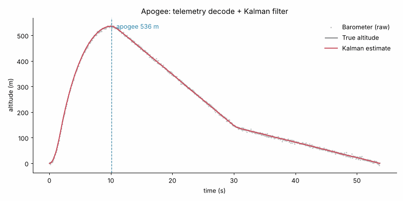

# Apogee

Ground-station software for a model rocket. It decodes the binary telemetry a
flight computer radios down and estimates altitude and velocity with a
**Kalman filter**, which merges a noisy barometer with an accelerometer.



```
$ python -m apogee --plot docs/flight.png
Packets sent 2686, decoded 2519, bad CRC 48, lost 167, resyncs 164
Apogee (Kalman):    536.0 m at t=10.08s
Apogee (true):      535.8 m
Max velocity:       128.6 m/s
Flight time:         53.7 s
Altitude error, RMS: raw barometer 2.98 m, Kalman 0.41 m
```

The filter cuts altitude error about **7×** compared with the raw barometer,
and apogee comes out within 0.2 m of the truth even though 6% of packets were
lost or corrupted on the link.

## What's inside

**1. Flight simulation** (`flight.py`): a 1-D model of a flight. The motor burns,
the rocket coasts to apogee, the drogue chute deploys, and the main chute opens at
150 m. It generates the ground truth, then adds realistic sensor noise.

**2. Binary packet protocol** (`packets.py`): every sample is packed into an
18-byte frame:

| Bytes | Field |
| --- | --- |
| 0–1 | sync word `0xA55A` |
| 2–3 | sequence number |
| 4–7 | time since launch (ms) |
| 8–11 | barometric altitude (float32) |
| 12–13 | vertical acceleration (milli-g, int16) |
| 14–15 | status bits: armed, drogue, main |
| 16–17 | **CRC-16/CCITT** checksum |

**3. Decoder built for a bad radio link**: the test link drops packets, flips
bits, and adds random noise bytes. The decoder:
- hunts for the sync word to **re-synchronize** after noise
- rejects any frame whose **CRC** doesn't match
- counts **lost packets** from gaps in the sequence numbers

**4. Kalman filter**: tracks altitude and velocity. Each step it *predicts*
using the accelerometer (physics), then *corrects* using the barometer (a
measurement), weighting each by how noisy it is. That's the same idea flight
computers, phones, and drones use to fuse their sensors.

## Run it

Requires Python 3.10+. The plot needs `matplotlib`.

```
python -m apogee                          # summary
python -m apogee --loss 0.2 --corrupt 0.1 # make the link worse
python -m apogee --plot flight.png        # save the chart
python -m pytest                          # 8 tests
```

The tests check the CRC against the standard's published check value
(`0x29B1`), make sure corrupted frames are rejected, test resync through noise
(including fake sync words), and confirm the Kalman estimate beats the raw
sensor.

## Ideas for next steps

- Read real packets from a serial port (`pyserial`) off an Arduino + LoRa radio
- Detect apogee in real time and fire the drogue on the descent
- Live dashboard in the browser
